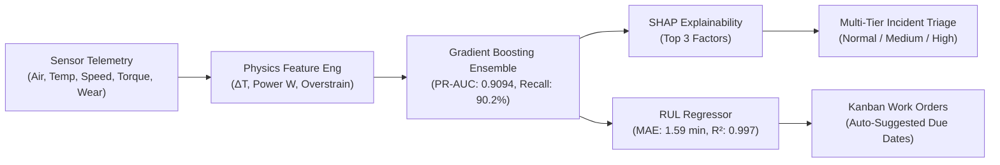

# MachineAlert AI – Industrial Predictive Maintenance & Early Warning System

[](https://www.python.org/)
[](https://fastapi.tiangolo.com/)
[](https://react.dev/)
[](https://tailwindcss.com/)
[](docs/ML_REPORT.md)
[](docs/ML_REPORT.md)
[](docs/ML_REPORT.md)
[](docs/TEST_REPORT.md)

> **College Mini Project – Practical No. 07:** Predictive equipment failure classification, Remaining Useful Life (RUL) regression, and automated incident triage on the **UCI AI4I 2020 Predictive Maintenance Dataset**.

---

## 1. Project Overview

**MachineAlert AI** is a production-grade predictive maintenance web platform designed for manufacturing shop floors. By continuously analyzing machine sensor telemetry (ambient & cutting process temperatures, spindle speed, cutting torque, and cumulative tool wear), the system predicts equipment failures before catastrophic breakdowns occur, diagnoses specific failure patterns (Heat Dissipation, Power Failure, Overstrain, Tool Wear), calculates Remaining Useful Life (RUL), and coordinates technician repairs via an interactive Kanban dispatch board.



---

## 2. Key Capabilities

- **Physics-Informed Feature Engineering:** Calculates temperature differential ($\Delta T$), mechanical power in Watts ($P = \tau \cdot \omega$), overstrain fatigue index ($\tau \cdot \text{wear}$), and wear velocity.
- **Safety-Critical Metric Optimization:** Tuned decision threshold ($0.290$) prioritizes **Recall ($90.20\%$)** and **PR-AUC ($0.9094$)**, catching 46 out of 51 failures with only 5 false negatives.
- **Derived Remaining Useful Life (RUL):** Predicts exact remaining operational minutes based on cutting tool wear limits ($200 - 240\text{ min}$) and failure risk adjustments.
- **Explainable AI (XAI):** Real-time SHAP TreeExplainer breaks down the top 3 driving risk factors per inference in plain operator language.
- **Root-Cause Pattern Diagnosis:** Maps anomalies to documented failure modes:
  - *Heat Dissipation Failure (HDF)*
  - *Power Failure (PWF)*
  - *Overstrain Failure (OSF)*
  - *Tool Wear Failure (TWF)*
- **Interactive Telemetry Simulator:** Single-step synthetic cycle trigger and background streaming worker emitting live sensor drift and fault conditions.
- **Batch CSV Scoring:** Drag-and-drop CSV upload for high-throughput multi-machine screening with downloadable results.
- **Maintenance Kanban Dispatch:** Move work orders across *Pending*, *In Progress*, and *Completed* with technician logs and auto-suggested due dates.

---

## 3. Tech Stack

- **Machine Learning:** Python 3.12, scikit-learn (Gradient Boosting, Random Forest), XGBoost, imbalanced-learn (SMOTE), SHAP, joblib, pandas, numpy, matplotlib, seaborn.
- **Backend API:** FastAPI, Uvicorn, SQLAlchemy ORM, SQLite (local dev) / PostgreSQL (production), Pydantic v2 validation, CORS enabled.
- **Frontend Dashboard:** React 18, Vite, TypeScript, Tailwind CSS, Recharts, Lucide Icons, TanStack React Query.
- **Testing:** Pytest & Starlette TestClient (backend), Vitest & React Testing Library (frontend), Automated Shell Smoke Tests.
- **Deployment:** Multi-stage Docker, `docker-compose.yml`, Google Cloud Run, Firebase Hosting / Vercel, Render Blueprint (`render.yaml`).

---

## 4. Repository Structure

```
machinealert-ai/
├── README.md                      # Project documentation and quickstart
├── docker-compose.yml              # Local container orchestration
├── render.yaml                     # Render.com Blueprint configuration
├── .env.example                    # Environment variable template
├── docs/                           # Comprehensive technical documentation
│   ├── ARCHITECTURE.md             # System design, dataflow, and C4 diagrams
│   ├── ML_REPORT.md                # ML methodology, SMOTE, RUL, and benchmarks
│   ├── API.md                      # REST API endpoint specification
│   ├── DEPLOY.md                   # Cloud deployment guides (Cloud Run, Hosting)
│   ├── USER_GUIDE.md               # Operator and maintenance walkthrough
│   ├── TEST_REPORT.md              # Test logs and metric floor verification
│   └── REQUIREMENTS_TRACEABILITY.md # Traceability matrix for Sections 1-8
├── ml/
│   ├── data/ (raw/, processed/)    # UCI AI4I 2020 dataset and splits
│   ├── src/
│   │   ├── download_data.py        # UCI download with synthetic fallback
│   │   ├── features.py             # Physics feature engineering
│   │   ├── preprocess.py           # Scaling, encoding, and SMOTE on train split
│   │   ├── train_classifier.py     # Classification pipeline & PR-AUC threshold tuning
│   │   ├── train_rul.py            # RUL regression model training
│   │   ├── evaluate.py             # Performance floor verification script
│   │   ├── explain.py              # SHAP TreeExplainer helper
│   │   └── image_pipeline.py       # Supplementary 2D sensor spectrogram CNN module
│   └── artifacts/                  # Persisted joblib models, metrics.json, and plots
├── backend/
│   ├── app/
│   │   ├── main.py                 # FastAPI application entrypoint
│   │   ├── config.py               # Pydantic BaseSettings & threshold configuration
│   │   ├── db.py                   # SQLAlchemy engine & session dependency
│   │   ├── models.py               # Machine, SensorReading, Alert, Maintenance ORM
│   │   ├── schemas.py              # Pydantic validation schemas
│   │   ├── ml_service.py           # Unified inference and SHAP service
│   │   ├── seed.py                 # Demo seeder (10 machines, 3 weeks history)
│   │   └── routers/                # Endpoints (predict, machines, alerts, maintenance, etc.)
│   ├── tests/
│   │   └── test_api.py             # 10 Pytest API integration tests (latency < 300ms)
│   ├── requirements.txt            # Python dependencies
│   └── Dockerfile                  # Multi-stage production container
├── frontend/                       # React 18 + Vite + TypeScript web application
│   ├── src/
│   │   ├── pages/                  # 10 complete application pages
│   │   ├── components/             # Layout (Sidebar, Header) and UI widgets
│   │   ├── tests/                  # Vitest component unit tests
│   │   ├── api.ts                  # Typed API fetch client
│   │   └── types.ts                # TypeScript interfaces
│   ├── package.json
│   ├── vite.config.ts
│   └── Dockerfile
└── scripts/
    ├── smoke_test.sh               # Bash automated smoke test script
    └── smoke_test.ps1              # PowerShell automated smoke test script
```

---

## 5. Quickstart Guide

### 1. Backend Setup:
```bash
cd backend
pip install -r requirements.txt
python -m app.seed                 # Seeds 10 machines, alerts & maintenance records
uvicorn app.main:app --reload --port 8000
```
API runs at `http://localhost:8000` (Swagger docs at `/docs`).

### 2. Frontend Setup:
```bash
cd frontend
npm install
npm run dev
```
Dashboard runs at `http://localhost:5173`.

### 3. Docker Compose (One-Command Run):
```bash
docker compose up --build
```

---

## 6. Verification & Test Execution

```bash
# Run Backend Pytest Suite (10 tests, latency < 300ms SLA):
cd backend
pytest tests/test_api.py -v

# Run Frontend Vitest Component Tests (4 tests):
cd frontend
npm run test

# Run ML Performance Floor Check:
python ml/src/evaluate.py

# Run Automated Smoke Test (PowerShell):
powershell -ExecutionPolicy Bypass -File scripts/smoke_test.ps1
```

---

## 7. Academic Practical Compliance (Practical No. 07)

1. **Class Imbalance:** SMOTE resampled the training fold ($7,000 \rightarrow 9,130$ samples) while holdout validation/test splits remained un-augmented with natural $3.4\%$ failure frequency.
2. **Derived RUL Target:** Formulated cutting tool physical proxy: $\text{RUL} = \max(0, 240 - \text{Tool\_Wear}) \times (1 - P(\text{failure})^{1.5})$, achieving test MAE of $1.59\text{ min}$ and $R^2 = 0.9970$.
3. **Supplementary Image Preprocessing Module:** Multi-sensor vectors converted into $64 \times 64$ 2D spectrogram heatmaps, augmented with Gaussian noise, spatial shifts, and flips, and evaluated on a 2D spatial CNN benchmark (`ml/src/image_pipeline.py`).
