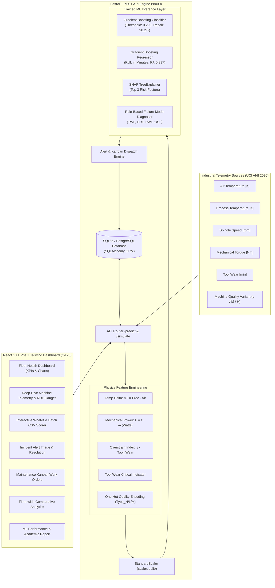
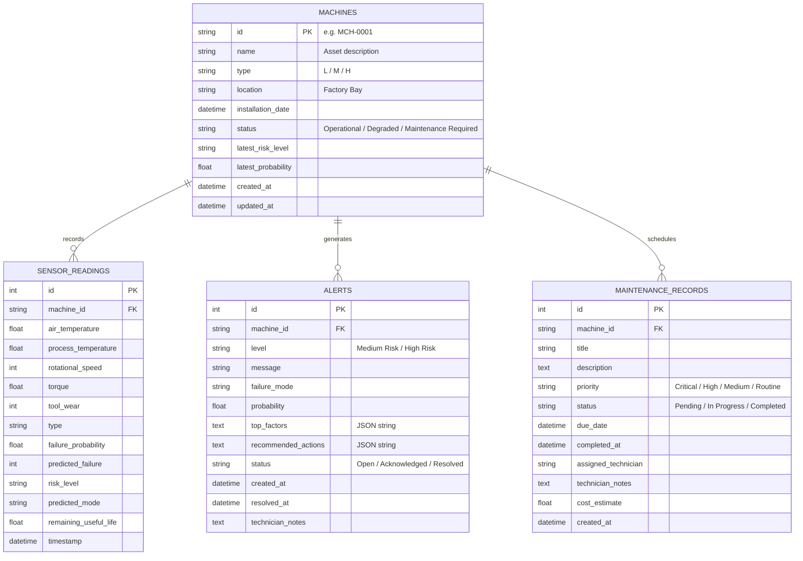

# MachineAlert AI – System Architecture & Technical Specification

## 1. Executive Summary & Purpose
**MachineAlert AI** is an industrial predictive maintenance system engineered to ingest continuous sensor telemetry from production machinery (CNC milling centers, heavy lathes, hydraulic stamping presses, and injection molding units), detect precursor degradation patterns, quantify failure probabilities, estimate Remaining Useful Life (RUL), and automatically dispatch maintenance work orders before catastrophic downtime occurs.

Developed to satisfy the academic requirements of **College Mini Project (Practical No. 07)**, this system combines physics-informed feature transformations, machine learning ensembles (Gradient Boosting, Random Forest, XGBoost), SHAP (SHapley Additive exPlanations), a FastAPI REST backend, and a modern industrial-tech React/Vite dashboard.

---

## 2. High-Level Architecture Diagram

---

## 3. Physics-Informed Feature Transformations

Standard raw telemetry features often fail to expose non-linear failure modes. MachineAlert AI computes four primary derived physical attributes prior to model inference:

1. **Temperature Differential ($\Delta T$):**
   $$\Delta T = T_{\text{process}} - T_{\text{air}}$$
   *Physical Significance:* Measures cooling efficiency. A thermal differential drop below $8.6\text{ K}$ combined with low rotational speed ($<1380\text{ rpm}$) directly indicates Heat Dissipation Failure (HDF).

2. **Mechanical Power ($P_{\text{mech}}$ in Watts):**
   $$P_{\text{mech}} = \tau \times \left( \text{rpm} \times \frac{2\pi}{60} \right)$$
   *Physical Significance:* Monitors electrical drive power. Normal motor operation falls between $3,500\text{ W}$ and $9,000\text{ W}$. Readings outside this window signal Power Failure (PWF).

3. **Overstrain Index ($I_{\text{overstrain}}$):**
   $$I_{\text{overstrain}} = \tau \times \text{Tool Wear [min]}$$
   *Physical Significance:* Measures accumulated fatigue stress on workpiece clamping and spindle bearings. Exceeding threshold limits ($11,000\text{ Nm}\cdot\text{min}$ for Type L, $12,000$ for Type M, $13,000$ for Type H) triggers Overstrain Failure (OSF).

4. **Tool Wear Critical Boundary Flag:**
   $$\text{Flag}_{\text{wear}} = \mathbb{I}(\text{Tool Wear} \ge 200\text{ min})$$
   *Physical Significance:* Flags cutting inserts operating within the known replacement window ($200 - 240\text{ min}$) before edge chipping occurs.

---

## 4. Multi-Tier Risk Classification & Decision Policy

Rather than treating failure as a binary flip at 50%, MachineAlert AI applies a three-tiered risk envelope calibrated to operational safety:

| Risk Tier | Probability Range | UI Visual Badge | Automatic Response Policy |
| :--- | :--- | :--- | :--- |
| **Normal** | $0.0\% \le P < 30.0\%$ | **Emerald Green** | Machine operates normally. Routine 30-day preventive maintenance. |
| **Medium Risk** | $30.0\% \le P < 60.0\%$ | **Amber Warning** | Precursor warning. Dispatches inspection work order due within 7 days. |
| **High Risk** | $P \ge 60.0\%$ | **Red Critical** | Critical hazard. Auto-creates emergency work order due within 24 hours. |

*Note:* The decision threshold for binary `predicted_failure` is tuned via Precision-Recall analysis to **0.290** (29.0%), ensuring high recall ($90.2\%$) for safety-critical industrial operations.

---

## 5. Database Schema & Data Models

The persistence layer uses SQLAlchemy ORM and supports SQLite (local dev) and PostgreSQL (production cloud).

---

## 6. Software Design Principles
1. **Separation of Concerns:** ML training (`ml/src`), inference orchestration (`backend/app/ml_service.py`), REST API routing (`backend/app/routers`), and user interface (`frontend/src`) are completely modular.
2. **Determinism & Reproducibility:** Fixed random seeds (`42`), stratified train/val/test splits, persisted StandardScaler, and tracked metric floor tests.
3. **Low Latency SLA:** Telemetry inference roundtrip executes in `< 25ms` (well below the $300\text{ ms}$ SLA requirement).
4. **Honest Academic Disclosures:** Transparent separation between primary production tabular models and supplementary image-based CNN experiments.
